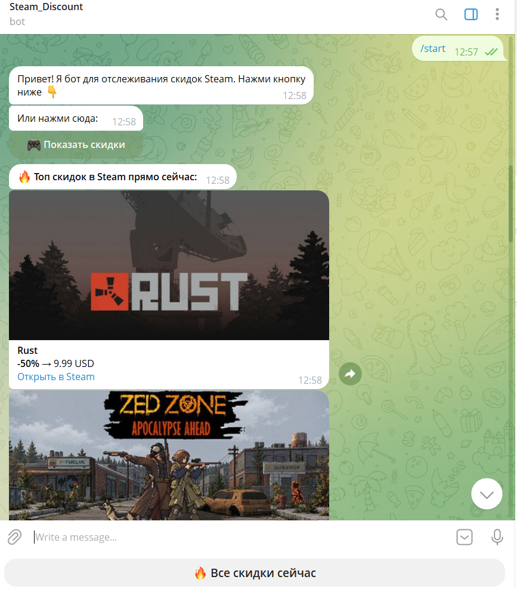
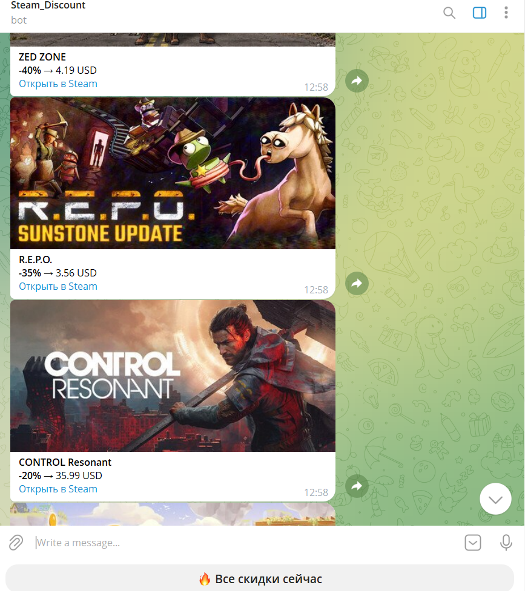

# 🎮 Steam Deals Telegram Bot

Telegram-бот, который ежедневно присылает уведомления о лучших скидках в Steam и позволяет запрашивать актуальные акции в один клик.

## Возможности
- 🆕 Уведомления о новых скидках (через официальный Steam API).
- ⏳ Напоминание в последний день действия скидки.
- 🔥 **Интерактивное меню**: кнопка для запроса топ-15 самых выгодных предложений прямо сейчас.
- 🖼 **Красочные уведомления**: каждая игра приходит с обложкой и описанием.
- 🇧🇾 **Региональные цены**: стоимость отображается с учетом рынка Беларуси (в BYN/USD_CIS).
- 🕒 Ежедневная автоматическая рассылка в 10:00 по Минску.

## Стек
- **Python 3.9+** (используется модуль `zoneinfo` для работы с часовыми поясами)
- **Telegram Bot API** (чистый `urllib`, без тяжелых фреймворков)
- **Steam Store API** (`featuredcategories`, `appdetails`)
- **python-dotenv** для безопасного хранения токенов

## Скриншоты

## Установка и запуск
1. Клонируйте репозиторий:
   git clone https://github.com/Ruslan-study/steam-deals-bot.git
   cd steam-deals-bot

2. Установите зависимости:
   pip install -r requirements.txt

3. Создайте файл .env на основе .env.example и впишите токены:
   BOT_TOKEN_STEAM=ваш_токен_от_BotFather
   CHAT_ID=ваш_id_от_userinfobot

4. Запустите бота:
   python steam_bot.py